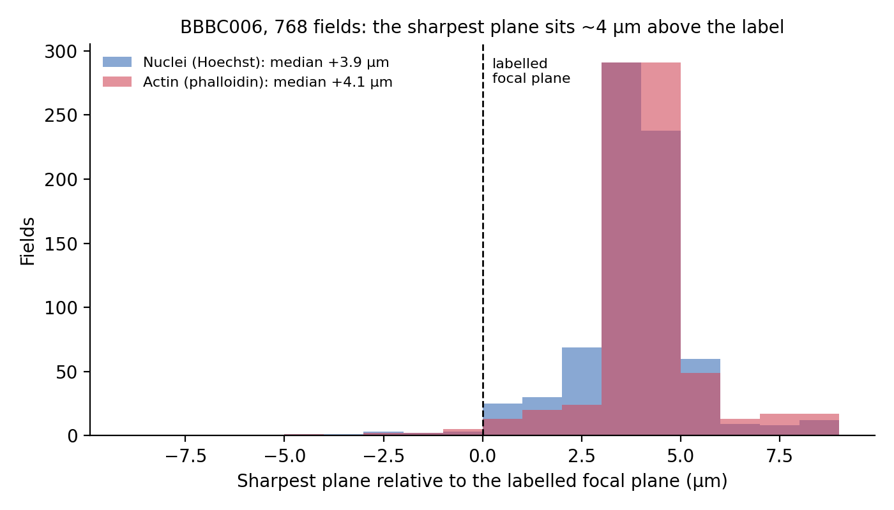
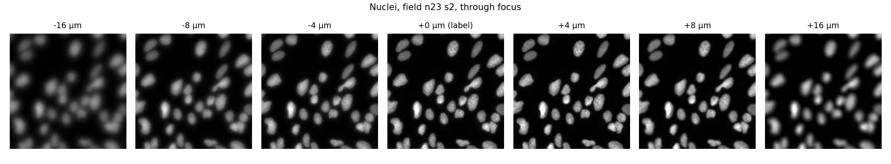
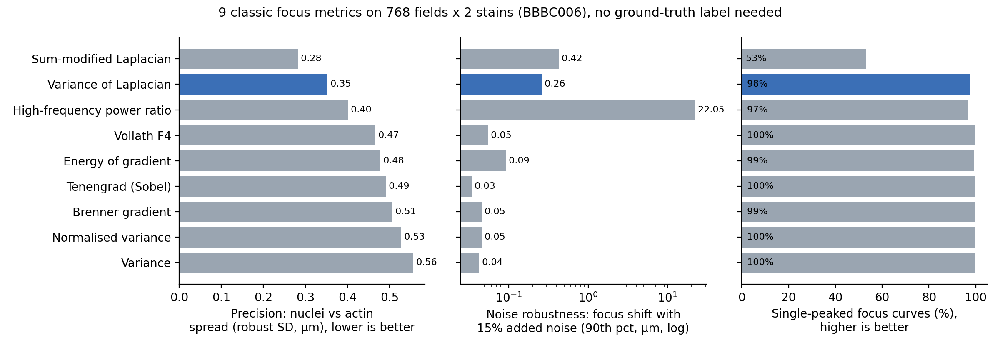
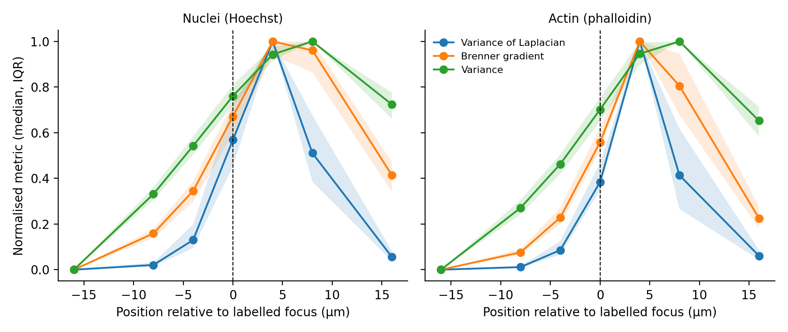

# Which autofocus metric actually works? A benchmark on 768 microscopy fields

[](https://github.com/mamoun-alaoui-slimani/focus-metrics-bbbc006/actions/workflows/tests.yml)

Autofocus in a fluorescence microscope comes down to one number per image: a
**sharpness metric** that should peak at best focus. There are dozens of them,
and the choice is usually made by habit. This repo compares nine classic metrics
on a public, real dataset and asks which ones are precise, robust to noise and
well behaved, without relying on a ground-truth label I could not verify.

## Data

[BBBC006](https://bbbc.broadinstitute.org/BBBC006) (Broad Bioimage Benchmark
Collection, CC0): U2OS cells, 384 wells x 2 sites = **768 fields**, two stains
(Hoechst for nuclei, phalloidin for actin), 696 x 520 px, 16-bit. Planes are 2 µm
apart and z = 16 is documented as the optimal focal plane. I used 7 planes:
z = 8, 12, 14, 16, 18, 20, 24, i.e. -16, -8, -4, 0, +4, +8, +16 µm around the
labelled plane (10,752 images).

> Ljosa V., Sokolnicki K.L., Carpenter A.E. *Annotated high-throughput microscopy
> image sets for validation.* Nature Methods 9, 637 (2012).

## Metrics

Variance, normalised variance, variance of Laplacian, sum-modified Laplacian,
Brenner gradient, Tenengrad (Sobel), energy of gradient, Vollath F4, and the
fraction of spectral power above 15% of Nyquist. Implementations are in
[`src/focus_metrics/metrics.py`](src/focus_metrics/metrics.py), each about five lines of NumPy/SciPy.

## Finding 1: the sharpest plane is not the labelled one

Every metric, on both stains, puts the sharpest plane **above** the documented
focal plane. With the variance of Laplacian, and a parabolic fit through the
peak and its neighbours for sub-plane precision, the median offset is
**+3.9 µm for nuclei and +4.0 µm for actin**. Only 1–8% of fields peak exactly
at z = 16, depending on the metric. Visual inspection agrees (figure 4: nuclear
texture is crispest at +4 µm).




I can't tell from the data whether this is a numbering offset in the release or
a real offset of the hardware autofocus. Either way, if you use BBBC006 to train
or test a focus model, check the "z = 16 is in focus" assumption first.
Scoring metrics by how often they hit z = 16 would mostly measure the label, so
the comparison below uses criteria that need no label.

## Finding 2: a label-free scorecard

* **Precision.** Nuclei and actin are imaged in the same field, so the
  difference between their estimated focal planes should be constant (up to a
  fixed chromatic offset). The spread of that difference across fields (robust
  SD) measures how precisely a metric locates focus.
* **Noise robustness.** How far the estimated focus moves when Gaussian noise
  (15% of the in-focus image SD) is added (90th percentile over fields).
* **Well-behaved curves.** Share of focus curves with a single peak, which
  matters for hill-climbing autofocus.



| Metric | Precision (µm, lower is better) | Shift under noise, p90 (µm) | Single-peaked | ms / image |
|---|---|---|---|---|
| Sum-modified Laplacian | **0.28** | 0.42 | 53% | 1.8 |
| **Variance of Laplacian** | 0.35 | 0.26 | 98% | 2.7 |
| High-frequency power ratio | 0.40 | 22.1 | 97% | 3.9 |
| Vollath F4 | 0.47 | 0.05 | 100% | 0.9 |
| Energy of gradient | 0.48 | 0.09 | 99% | 1.1 |
| Tenengrad (Sobel) | 0.49 | 0.03 | 100% | 4.7 |
| Brenner gradient | 0.51 | 0.05 | 99% | 0.6 |
| Normalised variance | 0.53 | 0.05 | 100% | 0.5 |
| Variance | 0.56 | 0.04 | 100% | 0.5 |

Reading it:

* **Variance of Laplacian is the best all-rounder**: second-best precision,
  stable under noise, and 98% single-peaked curves.
* **Sum-modified Laplacian is the most precise but only 53% single-peaked**, so
  it suits an exhaustive z-scan better than a hill-climbing search.
* **The high-frequency power ratio fails badly with noise.** Noise adds
  high-frequency power everywhere, so on defocused planes, where the image has
  little high-frequency signal left, the ratio is dominated by noise and can
  peak far from focus.
* **Variance and the gradient metrics look very robust to noise, but partly
  because their peaks are broad** (figure 3): they peak 1–4 µm further from the
  Laplacian estimate and separate neighbouring planes less sharply.



## Limitations

* Seven planes, 4 µm apart near focus, so sub-plane estimates rely on a
  three-point parabolic fit.
* One cell line, two stains, one microscope. Brightfield or tissue sections may
  rank differently.
* The precision criterion assumes the chromatic offset between the two
  channels is constant across fields.
* No learned (CNN) focus model yet. That is the natural next step, ideally
  trained on labels corrected for the offset above.

## Run it

```bash
pip install -e ".[benchmark]"
# download BBBC006_v1_images_z_{08,12,14,16,18,20,24}.zip from the BBBC page and unzip into DATA/
python src/run_benchmark.py DATA results           # ~3 min on 4 cores; optional START END args to chunk
python src/analyse.py results DATA                 # scorecard.csv + figures
```

## Use the metrics in your own code

The metrics are packaged as `focus_metrics` (NumPy + SciPy only):

```python
from focus_metrics import best_focus, focus_curve

z_um = [-16, -8, -4, 0, 4, 8, 16]
best_focus(stack, z=z_um)                       # sub-plane estimate, variance of Laplacian by default
focus_curve(stack, metric="Brenner gradient")   # one value per plane
```

## Tests

```bash
pip install -e ".[test]"
pytest
```

The tests run on synthetic fields with known focus, so they need no data
download, and CI runs them with `ruff` on Python 3.10 to 3.13. They check that
every metric is zero on a flat image, peaks at the in-focus plane, and decreases
monotonically with blur; how each metric scales with detector gain; that
derivative-based metrics ignore a constant background offset; and that the
sub-plane parabola recovers a known vertex on the uneven BBBC006 plane spacing.
Two checks are deliberately skipped: plain variance is not held to the
monotonic-blur test (it measures contrast, not sharpness), and Vollath F4 is not
offset-invariant (a background offset leaks in through the edge columns).

---

Mamoun Alaoui Slimani, MSc Applied Physics (EPFL). My MSc thesis was on image
quality and optical characterisation for a multichannel fluorescence
microscope; this is a public-data follow-up.
